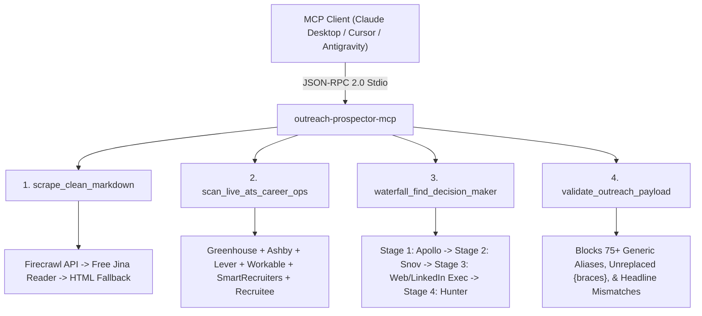

# `outreach-prospector-mcp` — Zero-Cost Waterfall Enrichment, 6-ATS Scanner & Pre-Send Gate MCP Server

[](LICENSE)
[](https://www.python.org/)
[](https://modelcontextprotocol.io)
[](https://glama.ai/mcp/servers/andrew4522-cr/outreach-prospector-mcp)

> **Enterprise B2B & Executive Prospecting without the $500/mo SaaS bloat.** A zero-dependency Model Context Protocol (MCP) server combining clean Markdown web scraping, live 6-ATS job board discovery, 4-stage executive waterfall enrichment, and hard pre-send quality gates.

Built by **Andrew Anderson** ([BridgingTheAIGap.com](https://www.bridgingtheaigap.com)).

---

## Architecture Overview



---

## Key Features

### 1. Clean Markdown Web & ATS Scraper (`scrape_clean_markdown`)
- Renders JS-heavy Next.js/React career pages, company `/about` pages, and ATS postings into clean, LLM-ready Markdown.
- Automatic 3-tier waterfall: **Firecrawl API** (if `FIRECRAWL_API_KEY` set) $\rightarrow$ **100% Free Jina Reader (`r.jina.ai`)** $\rightarrow$ **Direct HTML-to-Markdown fallback**.

### 2. Live 6-ATS Public API Scanner (`scan_live_ats_career_ops`)
- Directly queries the public JSON posting APIs of **6 major Applicant Tracking Systems** with zero paid API keys required:
  - **Greenhouse** (`boards-api.greenhouse.io`)
  - **Ashby** (`api.ashbyhq.com`)
  - **Lever** (`api.lever.co`)
  - **Workable** (`apply.workable.com/api/v3`)
  - **SmartRecruiters** (`api.smartrecruiters.com`)
  - **Recruitee** (`*.recruitee.com/api/offers`)
- Includes live search discovery to find newly posted roles outside static company slug lists and automatically classifies roles into single-angle tracks (`AI`, `MARKETING`, `OPERATIONS`).

### 3. 4-Stage Executive Waterfall Enrichment (`waterfall_find_decision_maker`)
- **Stage 1:** Apollo.io People Search & Match API (`APOLLO_API_KEY`).
- **Stage 2:** Snov.io Domain Prospect Search (`SNOV_CLIENT_ID` / `SNOV_CLIENT_SECRET`), automatically rejecting `invalid` and `not_verified` guesses.
- **Stage 3:** Web & LinkedIn Named Executive Discovery (`discover_executives_from_web`) across `/about`, `/team`, and search indexes, chained into Hunter.io / Snov Name-to-Email resolution.
- **Strict Role Hygiene:** Automatically excludes board chairmen, non-executive directors, podcast hosts, career coaches, legal counsel, and former employees (`ex-`, `former`).

### 4. Hard Pre-Send Quality Gates (`validate_outreach_payload`)
- **75+ Generic Inbox Blocklist:** Blocks `info@`, `careers@`, `talent@`, `support@`, `dataprotection@`, `press@`, `tellmemore@`, and leading HTML unicode escape artifacts (`u003e`).
- **Zero Unreplaced Placeholders:** Blocks any outbound payload containing raw `{first_name}` or `{{company}}` braces.
- **Headline-to-Company Verification:** Verifies extracted company tokens across all headline separators (`at`, `@`, `-`, `–`, `|`) before sending any LinkedIn DM.
- **Approval-Gated LinkedIn Drafting (`prepare_linkedin_outreach_for_approval`):** Stages tailored single-angle `X -> Y -> Z` outreach drafts in `PENDING_APPROVAL` state.

---

## Installation

```bash
pip install git+https://github.com/andrew4522-cr/outreach-prospector-mcp.git
```

Or clone locally:
```bash
git clone https://github.com/andrew4522-cr/outreach-prospector-mcp.git
cd outreach-prospector-mcp
pip install -e .
```

---

## MCP Client Configuration (Claude Desktop / Cursor / Antigravity)

Add to your `mcp_config.json` or `claude_desktop_config.json`:

```json
{
  "mcpServers": {
    "outreach_prospector": {
      "command": "outreach-prospector-mcp",
      "env": {
        "APOLLO_API_KEY": "optional_apollo_key",
        "SNOV_CLIENT_ID": "optional_snov_id",
        "SNOV_CLIENT_SECRET": "optional_snov_secret",
        "FIRECRAWL_API_KEY": "optional_firecrawl_key"
      }
    }
  }
}
```

---

## Standalone CLI Usage

```bash
# 1. Scrape any URL into clean Markdown (zero API keys required)
outreach-prospector-mcp --scrape "https://stripe.com/jobs"

# 2. Scan live Greenhouse, Ashby, Lever, Workable, SmartRecruiters & Recruitee boards
outreach-prospector-mcp --scan-ats

# 3. Run 4-stage waterfall decision-maker discovery for a target company
outreach-prospector-mcp --waterfall "ElevenLabs" "elevenlabs.io"
```

---

## Running Tests

```bash
python -m unittest discover -s tests -v
```

---

## License

MIT License © 2026 [Andrew Anderson](https://www.bridgingtheaigap.com)
